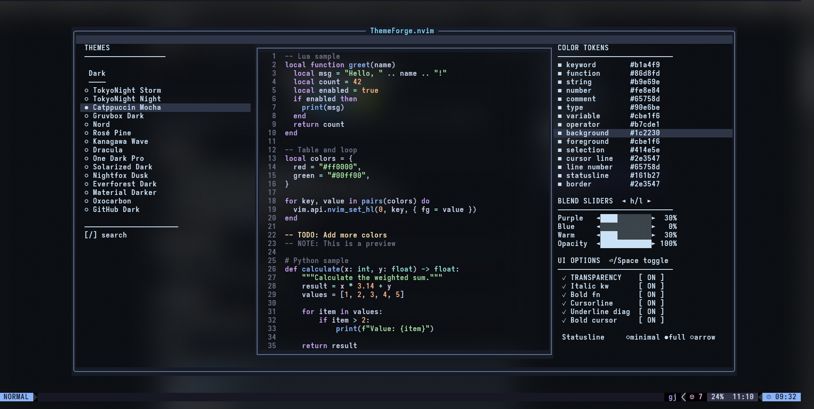
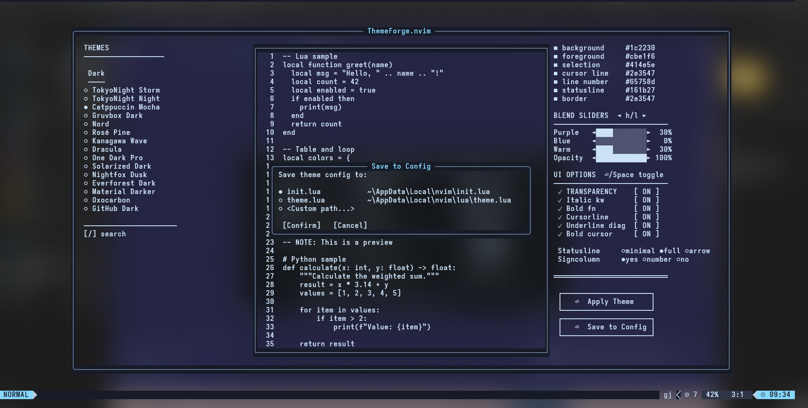
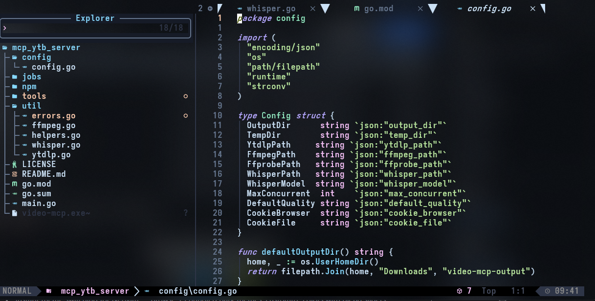

<h1 align="center">ThemeForge.nvim</h1>

<p align="center">
  
  <a href="https://github.com/j4flmao/themeforge_nvim/blob/main/LICENSE">
    
  </a>
</p>

> A visual theme workbench for Neovim — discover, tune, check readability, and save 15 bundled dark themes.

## Features

- 15 bundled dark themes — no internet required
- Live preview with color blending sliders (Purple, Blue, Green, Cyan, Pink, Orange, Warm, Saturation, Brightness, Opacity)
- UI customization (transparency, bold keywords, bold functions, cursor styling)
- Readability feedback for text and comments while tuning a palette
- Diagnose contrast and plugin highlight coverage with `:ThemeForge doctor`
- Save/load theme configurations
- Auto-compatible with popular Neovim plugins

## Screenshots

<p align="center">
  
</p>

<p align="center">
  
</p>

<p align="center">
  
</p>

## Requirements

- Neovim >= 0.9.0
- Pure Lua core with no external image-processing dependency

## Installation

### Using a package manager

#### lazy.nvim

```lua
-- lua/plugins/themeforge.lua
return {
  "j4flmao/themeforge_nvim",
  lazy = false,
  priority = 1000,
  config = function()
    require("themeforge").setup({
      default_theme = "tokyonight-storm",
    })
  end,
}
```

#### Manual

```bash
# Clone into your runtime path
git clone https://github.com/j4flmao/themeforge_nvim ~/.local/share/nvim/site/pack/vendor/start/themeforge_nvim
```

Then add to your `init.lua`:

```lua
require("themeforge").setup({ default_theme = "tokyonight-storm" })
```

## Quick Start

```vim
:ThemeForge
```

Opens the interactive theme panel. Browse themes and adjust blend sliders with `h`/`l`; changes remain a preview until you press `a` or Apply Theme.

## Commands

| Command | Description |
|---------|------------|
| `:ThemeForge` | Open theme panel |
| `:ThemeForge open` | Open theme panel |
| `:ThemeForge close` | Close panel |
| `:ThemeForge apply [theme]` | Apply theme directly |
| `:ThemeForge save [file]` | Save to config file |
| `:ThemeForge reset` | Reset all overrides |
| `:ThemeForge list` | List all themes |
| `:ThemeForge status` | Show active theme |
| `:ThemeForge save-blend [name]` | Save the current palette blend |
| `:ThemeForge doctor` | Check contrast and integrations |

## Keybindings

Inside the panel:

| Key | Action |
|-----|-------|
| `Tab` | Next region |
| `S-Tab` | Prev region |
| `j` / `k` | Navigate list |
| `Enter` | Select / confirm |
| `Space` | Toggle option |
| `h` / `l` | Slider ±5% |
| `H` / `L` | Slider ±10% |
| `0` | Reset slider |
| `a` | Apply theme |
| `s` | Save to file |
| `r` | Reset overrides |
| `/` | Search themes |
| `q` / `Esc` | Close panel |
| `?` | Show help |

## Configuration

```lua
require("themeforge").setup({
  default_theme    = "tokyonight-storm",
  restore_on_start = true,
  
  panel = {
    width_ratio  = 0.82,
    height_ratio = 0.82,
    border       = "rounded",
  },
  
  ui = {
    transparency    = false,
    italic_keywords = false,
    bold_functions  = false,
    cursorline       = true,
    underline_diag  = true,
    bold_cursor      = true,
    signcolumn       = "yes",
    statusline       = "full",
  },
})
```

### Options

| Option | Type | Default | Description |
|--------|------|---------|-------------|
| `default_theme` | string | `"tokyonight-storm"` | Default theme on startup |
| `restore_on_start` | boolean | `true` | Restore last used theme |
| `panel.width_ratio` | number | `0.82` | Panel width (0-1) |
| `panel.height_ratio` | number | `0.82` | Panel height (0-1) |
| `panel.border` | string | `"rounded"` | Border style |
| `ui.transparency` | boolean | `false` | Enable transparent backgrounds |
| `ui.italic_keywords` | boolean | `false` | Italic keywords |
| `ui.bold_functions` | boolean | `false` | Bold functions |
| `ui.cursorline` | boolean | `true` | Show cursor line |
| `ui.underline_diag` | boolean | `true` | Underline diagnostics |
| `ui.bold_cursor` | boolean | `true` | Bold cursor/selection |
| `ui.signcolumn` | string | `"yes"` | Signcolumn: yes/number/no |
| `ui.statusline` | string | `"full"` | Statusline: minimal/full/arrow |

## API

```lua
local tf = require("themeforge")

-- Initialize
tf.setup({ default_theme = "tokyonight-storm" })

-- Open/close UI
tf.open()
tf.close()

-- Apply theme
tf.apply("tokyonight-night")
tf.apply({ theme = "github-dark", ui = { bold_cursor = true } })

-- Save/reset
tf.save("~/.config/nvim/themes.lua")
tf.reset()
tf.doctor()
```


## Bundled Themes (15)

| ID | Name |
|----|------|
| `tokyonight-storm` | TokyoNight Storm |
| `tokyonight-night` | TokyoNight Night |
| `catppuccin-mocha` | Catppuccin Mocha |
| `gruvbox-dark` | Gruvbox Dark |
| `nord` | Nord |
| `rose-pine` | Rosé Pine |
| `kanagawa-wave` | Kanagawa Wave |
| `dracula` | Dracula |
| `onedark` | One Dark Pro |
| `solarized-dark` | Solarized Dark |
| `nightfox` | Nightfox |
| `everforest` | Everforest Dark |
| `material-darker` | Material Darker |
| `oxocarbon` | Oxocarbon |
| `github-dark` | GitHub Dark |

## Auto-Compatible Plugins

ThemeForge automatically applies highlights for:

- nvim-cmp
- nvim-tree / neo-tree
- telescope
- gitsigns
- indent-blankline
- which-key
- lualine
- bufferline

## Contributing

Contributions are welcome! Please open an issue or submit a PR.

1. Fork the repository
2. Create your feature branch (`git checkout -b feature/amazing-feature`)
3. Commit your changes (`git commit -m 'feat: add amazing feature'`)
4. Push to the branch (`git push origin feature/amazing-feature`)
5. Open a Pull Request

## License

MIT License — see [LICENSE](LICENSE) for details.

---

<p align="center">
  Made with ❤️ by <a href="https://github.com/j4flmao">j4flmao</a>
</p>
